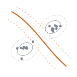
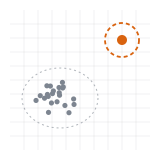
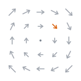
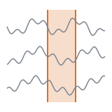
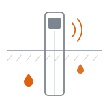
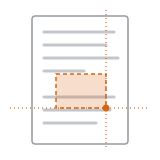

<b>Fig. 1</b>&ensp;Gaussian-process posterior, mean ± 1σ / 2σ. Confidence is highest near observed data, and shortly after coffee.

**Dr.-Ing. in computer science**, working on uncertainty quantification. Homelab, IoT, tennis and coffee on the side.

[LinkedIn](https://www.linkedin.com/in/philipp-oberdiek/) &ensp;·&ensp; [oberdiek.net](https://oberdiek.net) &ensp;·&ensp; [Google Scholar](https://scholar.google.com/citations?user=csh8_YkAAAAJ) &ensp;·&ensp; [Email](mailto:git@oberdiek.net)

## About

My PhD at TU Dortmund, *Assessing the Reliability of Deep Neural Networks* (2023), was about **uncertainty quantification**: teaching models to know when they don't know. That question still drives most of what I build.

Away from research, I run a homelab where I self-host just about everything (Proxmox, Docker, Ansible, with Grafana and Prometheus watching all of it) and design small battery-powered IoT devices. Off-screen, you'll find me on a tennis court or next to an espresso machine.

## Selected work

<table>
<tr>
<td width="50%" valign="top">

### [UQGAN](https://github.com/RonMcKay/UQGAN)

RESEARCH · PYTHON · <b>NEURIPS 2022</b>

Unified uncertainty quantification for deep classifiers, trained via conditional GANs.

</td>
<td width="50%" valign="top">

### [OODRetrieval](https://github.com/RonMcKay/OODRetrieval)

RESEARCH · PYTHON · <b>CVPR WORKSHOPS 2020</b>

Detection and retrieval of out-of-distribution objects in semantic segmentation.

</td>
</tr>
<tr>
<td width="50%" valign="top">

### [gradient_metrics](https://github.com/RonMcKay/gradient_metrics)

LIBRARY · PYTHON · <b>ANNPR 2018</b>

Gradient-based uncertainty metrics for neural networks, built on PyTorch.

</td>
<td width="50%" valign="top">

### [annotation-tool](https://github.com/TUD-Patrec/annotation-tool)

TOOL · PYTHON

Annotate time-series data from sources such as motion capture and video.

</td>
</tr>
<tr>
<td width="50%" valign="top">

### [Soil moisture sensor](https://github.com/RonMcKay/capacitive-soil-moisture-sensor)

HARDWARE · IOT

A compact, battery-powered capacitive soil moisture sensor.

</td>
<td width="50%" valign="top">

### [Zotero crosshair](https://github.com/RonMcKay/zotero-annotation-cross-hair)

PLUGIN · TYPESCRIPT

Page-wide crosshair guides for area annotations in Zotero's PDF reader.

</td>
</tr>
</table>

## Toolbox

| Model | Run | Observe | Write | Always |
| :-- | :-- | :-- | :-- | :-- |
| PyTorch Jupyter NumPy | Proxmox Docker Ansible | Grafana Prometheus &nbsp; | LaTeX Vim VS Code | Linux Git GitHub |
