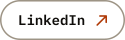
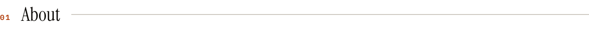
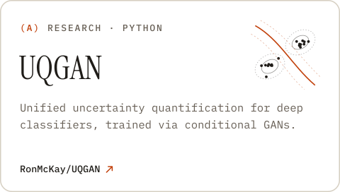
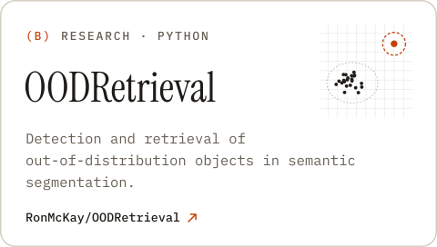
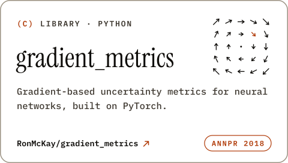
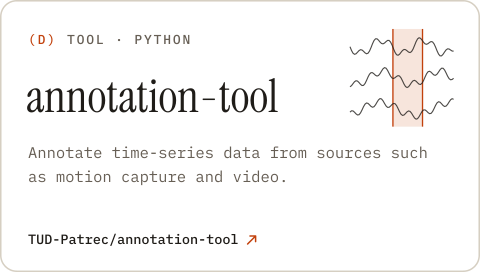
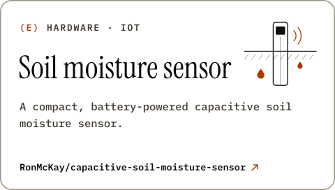
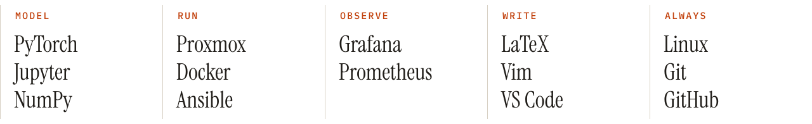

<picture>
  <source media="(prefers-color-scheme: dark)" srcset="assets/svg/header-dark.svg">
  <source media="(prefers-color-scheme: light)" srcset="assets/svg/header-light.svg">
  
</picture>

  <a href="https://www.linkedin.com/in/philipp-oberdiek/"><picture><source media="(prefers-color-scheme: dark)" srcset="assets/svg/link-linkedin-dark.svg"><source media="(prefers-color-scheme: light)" srcset="assets/svg/link-linkedin-light.svg"></picture></a>
  <a href="https://oberdiek.net"><picture><source media="(prefers-color-scheme: dark)" srcset="assets/svg/link-homepage-dark.svg"><source media="(prefers-color-scheme: light)" srcset="assets/svg/link-homepage-light.svg"></picture></a>
  <a href="https://scholar.google.com/citations?user=csh8_YkAAAAJ"><picture><source media="(prefers-color-scheme: dark)" srcset="assets/svg/link-scholar-dark.svg"><source media="(prefers-color-scheme: light)" srcset="assets/svg/link-scholar-light.svg"></picture></a>
  <a href="mailto:git@oberdiek.net"><picture><source media="(prefers-color-scheme: dark)" srcset="assets/svg/link-email-dark.svg"><source media="(prefers-color-scheme: light)" srcset="assets/svg/link-email-light.svg"></picture></a>

 

<picture>
  <source media="(prefers-color-scheme: dark)" srcset="assets/svg/section-about-dark.svg">
  <source media="(prefers-color-scheme: light)" srcset="assets/svg/section-about-light.svg">
  
</picture>

My PhD was about **uncertainty quantification for deep neural networks**: teaching models to know when they don't know. That question still drives most of what I build.

Away from research, I run a homelab where I self-host just about everything (Proxmox, Docker, Ansible, with Grafana and Prometheus watching all of it) and design small battery-powered IoT devices. Off-screen, you'll find me on a tennis court or next to an espresso machine.

 

<picture>
  <source media="(prefers-color-scheme: dark)" srcset="assets/svg/section-work-dark.svg">
  <source media="(prefers-color-scheme: light)" srcset="assets/svg/section-work-light.svg">
  
</picture>

  <a href="https://github.com/RonMcKay/UQGAN"><picture><source media="(prefers-color-scheme: dark)" srcset="assets/svg/card-uqgan-dark.svg"><source media="(prefers-color-scheme: light)" srcset="assets/svg/card-uqgan-light.svg"></picture></a>
  <a href="https://github.com/RonMcKay/OODRetrieval"><picture><source media="(prefers-color-scheme: dark)" srcset="assets/svg/card-oodretrieval-dark.svg"><source media="(prefers-color-scheme: light)" srcset="assets/svg/card-oodretrieval-light.svg"></picture></a>
  <a href="https://github.com/RonMcKay/gradient_metrics"><picture><source media="(prefers-color-scheme: dark)" srcset="assets/svg/card-gradient-metrics-dark.svg"><source media="(prefers-color-scheme: light)" srcset="assets/svg/card-gradient-metrics-light.svg"></picture></a>
  <a href="https://github.com/TUD-Patrec/annotation-tool"><picture><source media="(prefers-color-scheme: dark)" srcset="assets/svg/card-annotation-tool-dark.svg"><source media="(prefers-color-scheme: light)" srcset="assets/svg/card-annotation-tool-light.svg"></picture></a>
  <a href="https://github.com/RonMcKay/capacitive-soil-moisture-sensor"><picture><source media="(prefers-color-scheme: dark)" srcset="assets/svg/card-soil-sensor-dark.svg"><source media="(prefers-color-scheme: light)" srcset="assets/svg/card-soil-sensor-light.svg"></picture></a>
  <a href="https://github.com/RonMcKay/zotero-annotation-cross-hair"><picture><source media="(prefers-color-scheme: dark)" srcset="assets/svg/card-zotero-crosshair-dark.svg"><source media="(prefers-color-scheme: light)" srcset="assets/svg/card-zotero-crosshair-light.svg"></picture></a>

 

<picture>
  <source media="(prefers-color-scheme: dark)" srcset="assets/svg/section-toolbox-dark.svg">
  <source media="(prefers-color-scheme: light)" srcset="assets/svg/section-toolbox-light.svg">
  
</picture>

<picture>
  <source media="(prefers-color-scheme: dark)" srcset="assets/svg/toolbox-dark.svg">
  <source media="(prefers-color-scheme: light)" srcset="assets/svg/toolbox-light.svg">
  
</picture>
