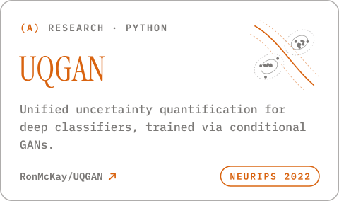
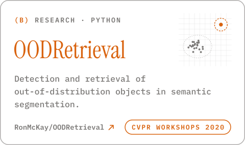
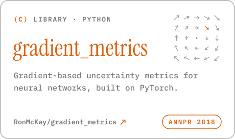
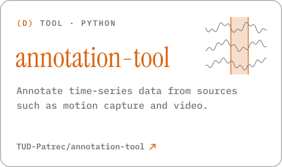
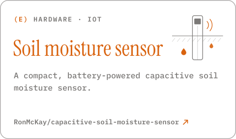
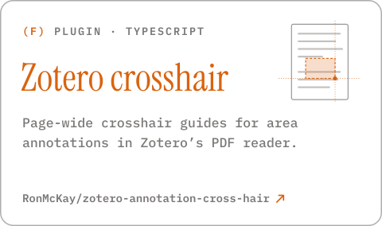

<b>Fig. 1</b>&ensp;Gaussian-process posterior, mean ± 1σ / 2σ. Confidence is highest near observed data, and shortly after coffee.

**Dr.-Ing. in computer science**, working on uncertainty quantification. Homelab, IoT, tennis and coffee on the side.

  
  
  
  

## About

My PhD at TU Dortmund, *Assessing the Reliability of Deep Neural Networks* (2023), was about **uncertainty quantification**: teaching models to know when they don't know. That question still drives most of what I build.

Away from research, I run a homelab where I self-host just about everything (Proxmox, Docker, Ansible, with Grafana and Prometheus watching all of it) and design small battery-powered IoT devices. Off-screen, you'll find me on a tennis court or next to an espresso machine.

## Selected work

  
  
  
  
  
  

## Toolbox

| Model | Run | Observe | Write | Always |
| :-- | :-- | :-- | :-- | :-- |
| PyTorch Jupyter NumPy | Proxmox Docker Ansible | Grafana Prometheus &nbsp; | LaTeX Vim VS Code | Linux Git GitHub |
